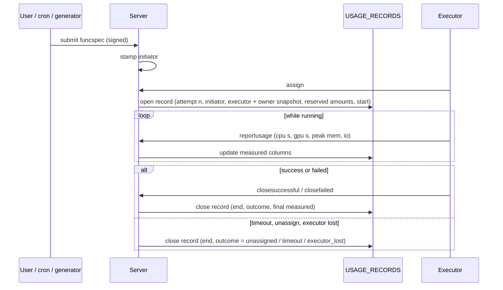

# Usage tracing in ColonyOS

Plan for recording who ran which task, on whose machine, with how much reserved and measured resource. The goal is an accurate, retention-proof record that answers two questions:

- Consumer view: what did I run, where, and how much CPU, GPU, memory and disk did it hold?
- Provider view: who ran on my machine, and for how long?

No pricing and no invoicing are part of this plan. The record must be good enough that credits between colony members, or a bill, could be derived from it later by a separate step. Based on an audit of colonyos/colonies at v1.9.10 and the sibling colonyos/executors repo, 2026-09-02.

## Summary

Reservation-based usage per user and per executor is computable today with one SQL query, because every process row already carries a verified initiator, the assigned executor id, start and end timestamps, and the requested CPU, memory, GPU, node and storage amounts normalized to integers.

It is not reliable enough to keep as a record, for five reasons:

- the process row is mutable and loses the previous executor on every retry
- the retention worker hard-deletes successful processes
- executor ids change on restart and hardware descriptions are overwritten in place
- nothing records who owns an executor, so the provider view has no data at all
- nothing anywhere measures actual consumption

Recommendation: add an append-only usage ledger written at assign and close, keyed per attempt, with the initiator, the executor's identity, its owner and its hardware denormalized at write time and exempt from retention. Record reserved capacity times wall time first, since that needs no executor changes. Add measured usage from executors as a second step, and storage tracking as a third. A balance query over the ledger then gives each member what they consumed and what their machines provided.

## What is recorded today

| Dimension | Source today | Status | Caveat |
|---|---|---|---|
| Who submitted | `PROCESSES.INITIATOR_ID`, `INITIATOR_NAME`, stamped from the recovered signing key | Good | Initiator may be a user or an executor. Children added at runtime via `addchildmsg` get no initiator at all. |
| Who owns the executor | Nothing. Registration requires the colony owner's key, so the recovered id at registration is the colony owner, not the machine owner. | Missing | The executor's own id is a key hash the executor process generates for itself; it names the process, not a person. |
| On behalf of which project or account | Nothing on the process. `Executor.Allocations` has a per-project map, but it is a self-reported blob with no entity behind it. | Missing | Colony is the only tenant boundary. Users have no role, group or account. |
| Which executor ran it | `PROCESSES.ASSIGNED_EXECUTOR_ID` | Fragile | Only the id, not the name. Cleared to empty on unassign, reset, timeout and executor removal. Executor ids change on restart when re-register is allowed. |
| Which machine | Nothing. `NODES` table and `EXECUTORS.NODE_ID` exist in the schema but are unwired; no hostname is captured anywhere. | Missing | `LocationName` is site-level. `Hardware.Network` and `Model` are free text. |
| Hardware class | `EXECUTORS.HARDWARE` JSON: model, cores, memory, GPU name and count | Fragile | Self-declared from env vars, never probed, overwritten in place with no history. A slice per executor, and the process does not say which entry it used. |
| When | `SUBMISSION_TIME`, `START_TIME`, `END_TIME` | Fragile | Overwritten on retry. Stored as zero time, not NULL, when unset. No arbitrary from-to query exists. |
| Reserved CPU, memory, GPU, nodes, storage, walltime | `CPU` (millicores), `MEMORY`, `STORAGE`, `GPUMEM` (bytes), `GPUCOUNT`, `NODES`, `WALLTIME` | Good | `GPUCOUNT` is a TEXT column. CPU strings without an `m` suffix parse to zero silently. |
| Consumed CPU seconds, GPU seconds, peak memory, I/O | Nothing, in either repo | Missing | The docker executor does not even apply CPU or memory limits, so requested is not an upper bound there. |
| Stored bytes | `FILES.SIZE` per file version, `COLONY_NAME`, `LABEL` | Partial | No owner column. Size is client-asserted, never checked against S3. No sum query. Deleting a file row does not delete the object. |
| Retention of the record | `ApplyRetentionPolicy` deletes SUCCESS processes, graphs, attributes and all logs older than the policy | Destructive | Default one week where enabled. FAILED rows are kept forever, so history would be biased toward failures. |
| Aggregation | Instantaneous counts only; per-function min/max/avg wait and exec time | Missing | No group-by user, executor or time bucket anywhere. Prometheus exports ten unlabeled gauges from a sidecar. |

Two existing pieces are worth reusing rather than replacing: `reportallocationmsg` is an already-wired executor-to-server channel for pushing usage numbers, and `BLUEPRINT_HISTORY` is the only append-only, retention-exempt table in the schema and a good template for the ledger.

## Gaps, ranked by how much they block a trustworthy record

1. One row per process, overwritten on retry. `Unassign` clears the executor id and the next assign overwrites start time. The first executor's runtime is unrecoverable; only the retry counter proves it happened. Executor removal does the same to everything the executor was running. (`pkg/database/postgresql/processes.go:994`, `:732`, `executors.go:335`)
2. Retention deletes the record. Successful processes older than `COLONIES_RETENTION_POLICY` are hard-deleted every minute by the leader. Any ledger must live in its own tables. (`pkg/database/postgresql/retention.go:18`, `internal/cli/server.go:62`)
3. No executor owner. The provider view cannot be built without knowing which colony member a machine belongs to. (`pkg/core/executor.go:59`, `pkg/server/handlers/executor/handlers.go:68`)
4. Executor identity is not stable. Re-registration deletes and re-inserts the row with a new id; reactivating an UNREGISTERED row overwrites the id, hardware and allocations in place. Old process rows then point at an id that no longer exists. (`pkg/server/handlers/executor/handlers.go:92`, `postgresql/executors.go:26`)
5. No consumption telemetry. Docker, kube and SLURM executors call only close or fail. No cgroup stats, no nvidia-smi, no sacct. Kube's utilization sums requests, not usage. (`executors/common/pkg/docker/docker_handler.go:276`, `k8s_handler.go:913`)
6. No machine entity. Several executors on one host cannot be grouped. The `NODES` table is created and dropped but never written or read, and the three node RPC messages have no handler. (`postgresql/database.go:470`, `postgresql/executors.go:131`)
7. Files have no owner and unverified sizes. `HandleAddFile` gets the recovered id but persists only colony and label. The server never touches S3. Snapshots are references and can dangle. (`pkg/server/handlers/file/handlers.go:52`, `pkg/fs/fs_client.go:87`)
8. No schema migration mechanism. No ALTER TABLE, no version table. Core tables use bare CREATE TABLE and every reader does `SELECT *` with positional scans, so adding a column to PROCESSES on a live deployment is not possible today. (`postgresql/database.go:917`, `processes.go:102`)
9. Parser hazards. CPU without an `m` suffix becomes 0 instead of an error; memory round-trips as MiB and truncates sub-MiB values; unit suffix matching iterates a map in random order. (`pkg/parsers/parser.go:10`, `:25`, `:80`)

## Target design

### Principles

- Append-only ledger, separate from the process table. Processes stay mutable and purgeable; usage records are never updated except to close them, and never deleted by retention.
- One record per attempt, not per process. A retried process produces two records with two executors and two durations.
- Denormalize identity at write time. Initiator, executor name, type, owner, location, node and a hardware snapshot are copied into the record when it opens, so later re-registration, ownership change or re-specification cannot change history.
- Record both reserved and measured. Reserved comes from the process row and is always present. Measured comes from the executor and may be absent; the record says which source filled each figure.
- Aggregate on the leader, idempotently. The same worker pattern as retention and cleanup, with upserts so a leadership flap cannot double count.
- No money in the server. The ledger stores units: seconds, core seconds, GPU seconds, byte seconds. Credits or prices are applied outside, or by a later optional step.

### Lifecycle of one usage record



### Executor ownership

The provider view needs one new fact: which colony member a machine belongs to.

- Add `Executor.OwnerID` and `Executor.OwnerName`, referring to a user in the same colony. Persisted as `EXECUTORS.OWNER_ID`, `OWNER_NAME`.
- Set at registration. Registration is done with the colony owner's key today, so the owner is passed explicitly: `colonies executor add --owner <username>` and `EXECUTOR_OWNER` in the executors repo. Empty means the colony itself owns the machine, which is the right default for shared infrastructure.
- Changeable by the colony owner via `updateexecutormsg`, and by the current owner. Every change is a new row in `EXECUTOR_HARDWARE_HISTORY`, so a record opened before the change keeps the old owner.
- Blueprint-managed executors inherit the owner of the reconciler executor that created them, unless the ExecutorDeployment spec sets one.
- Each usage record copies `owner_id` and `owner_name` at open time as `provider_id`, `provider_name`. A record whose initiator equals its provider is self-use, and the balance query treats it separately.

### New tables

| Table | Grain | Key columns | Notes |
|---|---|---|---|
| `USAGE_RECORDS` | One process attempt | id, colony, process_id, attempt, processgraph_id, initiator_id, initiator_name, initiator_kind (user or executor), label, funcname, executor_id, executor_name, executor_type, provider_id, provider_name, location_name, node_id, hardware_hash, reserved cpu_millis, mem_bytes, gpu_count, gpu_name, gpu_mem_bytes, nodes, storage_bytes, start_time, end_time, outcome, measured cpu_seconds, gpu_seconds, mem_peak_bytes, mem_byte_seconds, io_read_bytes, io_write_bytes, measured_source, last_report_time | Hypertable on start_time when TimescaleDB is on. Indexes on (colony, start_time), (colony, initiator_id, start_time), (colony, provider_id, start_time), (colony, executor_name, start_time), (process_id). Written with CREATE TABLE IF NOT EXISTS so it is safe on existing deployments. |
| `EXECUTOR_HARDWARE_HISTORY` | One capabilities or ownership version | hardware_hash, colony, executor_name, executor_id, owner_id, owner_name, hardware_json, software_json, valid_from, valid_to | Written on register, re-register, `updateexecutormsg` and owner change. Records reference it by hash, so hardware is stored once per version instead of per record. |
| `USAGE_HOURLY` | One (colony, initiator, provider, executor_name, node, executor_type, hour) | the same sums as the records plus attempt count and outcome counts | Filled by the leader worker with upsert. Optional TimescaleDB continuous aggregate later. |
| `STORAGE_USAGE` | One (colony, label, owner, day) | bytes_current, bytes_all_versions, file_count, sampled_at | See disk tracking below. |
| `SCHEMA_VERSION` | One row | version, applied_at | Prerequisite for the column additions below. |

### Changes to existing tables

- `EXECUTORS.OWNER_ID TEXT`, `OWNER_NAME TEXT`, as above.
- `FILES.OWNER_ID TEXT`, filled from the recovered id in `HandleAddFile`.
- `EXECUTORS.NODE_ID` starts being written; the `NODES` table gets a Go type, a database interface and the three already-defined RPC handlers.
- Retention SQL gains nothing to delete from usage tables. A separate `COLONIES_USAGE_RETENTION` knob, default off, governs the ledger.
- No new column on PROCESSES is needed for tracing. A project or account column can be added later behind the same migration mechanism if grouping by project becomes a requirement.

### Write points in the server

| Event | Where | Ledger action |
|---|---|---|
| Assign (exclusive) | `ColoniesController.Assign` after `processDB.Assign` | Open record. Read executor row once, copy name, type, owner, location, node, hardware hash. |
| Assign (distributed) | `SelectAndAssign` single SQL statement | Extend the same transaction with an INSERT ... SELECT from the RETURNING row joined to EXECUTORS so assignment and ledger open cannot diverge. |
| Close successful / failed | `CloseSuccessful`, `CloseFailed` | Close the open record with outcome. Make `MarkFailed` return durations like `MarkSuccessful` does. |
| Timeout, unassign, reset | `TimeoutLoop`, `Unassign`, `ResetProcess` | Close with outcome timeout or unassigned before the process row is mutated. |
| Executor removed or stale | `RemoveExecutorByName`, `cleanupStaleExecutors` | Close every open record of that executor with outcome executor_lost. |
| Usage report | New `reportusagemsg`, assigned executor only, process must be RUNNING | Update measured columns on the open record. Idempotent: values are absolute totals, not deltas, so a repeated report is harmless. |
| Register / update capabilities / change owner | `HandleAddExecutor`, `HandleUpdateExecutor` | Close the previous hardware history row, insert the new one, compute hash. |
| Add child | `HandleAddChild` | Copy initiator from the parent process. This is a bug fix independent of the ledger. |

### Read paths

- Database interface `UsageDatabase` added to the `Database` composite: `OpenUsageRecord`, `CloseUsageRecord`, `SetMeasuredUsage`, `CloseUsageRecordsByExecutor`, `QueryUsage(colony, from, to, filters, groupBy)`, `QueryBalance(colony, from, to)`, `RollupUsageHourly(from, to)`.
- RPC `getusagemsg`: colony owner sees everything in the colony; a member sees rows where they are the initiator or the provider. So a machine owner can always see who ran on their hardware, and a user can always see what they ran.
- CLI, consumer view: `colonies usage ls --from --to --group-by initiator|executor|provider|node|label`. Columns: attempts, wall hours, reserved core hours, reserved GPU hours, reserved GB hours, measured core hours, measured GPU hours, peak memory.
- CLI, provider view: `colonies usage ls --provider me --group-by initiator` lists who used my machines and how much. `colonies usage balance` shows, per colony member, provided minus consumed over the period, with self-use shown as its own column. The unit is core hours and GPU hours; converting that into credits is a policy decision left outside the server.
- Export: `colonies usage export --format csv|json` for the raw records or the hourly rollup.
- Prometheus, in the sidecar: counters `colonies_usage_cpu_seconds_total`, `gpu_seconds_total`, `wall_seconds_total` labeled by colony, executor_type and provider, read from `USAGE_HOURLY`.

### Units, fixed once

- CPU: millicores reserved; CPU seconds measured (cgroup `usage_usec` divided by 1e6). Core hours = millicores x wall seconds / 1000 / 3600.
- GPU: count reserved; GPU seconds measured = count x wall seconds, or DCGM active seconds where available.
- Memory: bytes reserved; byte seconds and peak bytes measured. Report unit GB hours.
- Disk: bytes; report unit GB months. Scratch storage reserved per process is a separate line from persistent files.

## Executor telemetry

Measured usage needs changes in the executors repo. Each backend already has a natural source. The report is sent on a timer while running and once more at close, so a lost executor still leaves partial usage in the ledger.

| Executor | Enforce reserved | Measure consumed | Source |
|---|---|---|---|
| docker | Set `NanoCPUs`, `Memory` and GPU `DeviceRequests` from Conditions. Today these lines are commented out. | `ContainerStats`: cpu_stats.total_usage, memory_stats.max_usage, blkio; nvidia-smi or DCGM for GPU. | common/pkg/docker/docker_handler.go:306 |
| kube | Already maps CPU, memory, GPU count, walltime into the Job template. | metrics-server pod metrics at intervals; container terminated state for exit; DCGM exporter for GPU. | common/pkg/k8s/job_tpl.go:28 |
| hpc / SLURM | Already maps nodes, tasks, cpus, mem, gres, time into sbatch. | `sacct -j ID --format=TotalCPU,MaxRSS,AllocTRES,Elapsed,NodeList` after completion. NodeList also gives machine identity for free. | common/pkg/slurm/slurm.go:99 |
| python, unix, echo | Not applicable | Process rusage where cheap; otherwise reserved only. | |

The executors repo vendors an older `pkg/core`: it assigns `Capabilities.Hardware.CPU` as a struct while the server now has `Hardware []Hardware`, and uses `Executor.Location` which is now `LocationName`. Bringing them onto the current core is a prerequisite for any of this.

## Disk tracking

Two different things count as disk. Keep them apart in the ledger.

- Scratch during a run: `Conditions.Storage` is already stored per process in bytes. It becomes a reserved column in the usage record and is reported as GB hours over the attempt's wall time. No executor changes needed.
- Persistent files in the Colonies FS: bytes held over time in S3, attributed to whoever uploaded them. Needs an owner column, a daily sampler, and a way to trust the numbers.

Steps for persistent files:

1. Add `FILES.OWNER_ID` and set it in `HandleAddFile`. Cost: one column, one line.
2. Add `SumFileSizes(colony, label, owner, currentVersionsOnly)`. Files are versioned by `SEQNR`, so the query must pick the max sequence number per (label, name) before summing, or it counts every historical version.
3. A leader worker samples per (colony, label, owner) once a day into `STORAGE_USAGE`. GB months are integrated from the daily samples. Sampling, not event sourcing, because file deletes are client-driven and lossy.
4. Verification: the server has the per-file S3 coordinates and credentials in the FILES row, so it can HEAD objects to check the claimed size and detect orphans in a slow background sweep. Until then sizes are client-asserted and reports should say so.
5. Snapshots need no size of their own. They reference file ids; a snapshot's bytes are the sum of its referenced current files. Deleting a file that a snapshot references should either be refused or recorded, or the snapshot's bytes become unrecoverable.

## Machine identity

"Which machine" has no answer today. The cheapest path is to finish the node concept that is already half in the schema.

- Node id at registration. Executors send `NodeID` = hostname, or `/etc/machine-id` where available, plus the probed capacity. SLURM executors report the node list per job from sacct instead, because one SLURM executor spans many machines.
- Wire the NODES table. A `core.Node` type, `NodeDatabase`, and handlers for the three existing `getnode*` messages. Executors upsert their node on register and heartbeat.
- Stable executor identity. Persist the executor keypair on disk in the executors repo so a restart keeps its id. On the server, stop overwriting `EXECUTOR_ID` when reactivating an UNREGISTERED row; write a new hardware history row instead.
- Blueprint-managed executors already carry `BlueprintID` and `BlueprintGen`, so a deployment's total can be rolled up from its replicas without a node id. The reconciler should still pass the docker host's hostname through as the node id.

## Phases

Ordered so that each phase produces something usable on its own. Effort is a rough size for one engineer familiar with the codebase, tests included.

### Phase 0: report from the process table (1 to 2 days, no schema change)

A reservation-based usage report straight from PROCESSES: `QueryUsage` grouping by initiator or executor over a from-to range, `getusagemsg`, and `colonies usage ls`. Fix the missing initiator on `HandleAddChild`. Make the CPU parser reject strings without a unit. Document that retention must be off, or long, for the figures to mean anything.

Output: per-user and per-executor core hours and GPU hours available immediately, with known caveats on retries and retention. No provider view yet, since executors have no owner.

### Phase 1: the ledger and executor ownership (1 to 2 weeks)

`SCHEMA_VERSION` and idempotent column adds in `Initialize`. `Executor.OwnerID` and `OwnerName` with `--owner` on registration. `USAGE_RECORDS`, `EXECUTOR_HARDWARE_HISTORY`, `UsageDatabase`, all write points listed above, the hourly rollup worker on the leader, retention exemption, and the query and CLI from phase 0 repointed at the ledger. `colonies usage balance` and `--provider me`. Executor id stops changing on reactivation.

Output: per-attempt, retention-proof, reservation-based usage with correct executor and owner attribution. Both the consumer and the provider view work.

### Phase 2: measured usage (1 to 2 weeks, mostly executors repo)

`reportusagemsg` and SDK support in Go and pycolonies. Bring the executors repo onto current `pkg/core`. Docker: enforce limits and read ContainerStats. Kube: metrics-server. SLURM: sacct at completion. Periodic reports while running.

Output: measured CPU seconds, GPU seconds and peak memory beside the reserved figures; the balance can be computed on either basis.

### Phase 3: machine identity (1 week)

`core.Node`, node handlers, node id at registration, persisted executor keys, per-node rollups and `--group-by node`.

Output: usage per physical machine, and several executors on one host roll up together under one owner.

### Phase 4: disk (1 week)

`FILES.OWNER_ID`, current-version size sums, daily `STORAGE_USAGE` sampler, S3 HEAD verification sweep, snapshot reference protection.

Output: GB months per owner and label, with a verified flag per sample.

### Later, only if needed

- A project or account entity with membership, and a `FunctionSpec.Account` column, so usage can be grouped by project rather than person.
- A credits policy: a per-colony weight per resource, a `colonies usage credits` command, and optionally the scheduler consulting a member's balance. This is where the existing unused `Allocations` struct would finally mean something.
- A rate card and invoice export, if a bill is ever wanted. Everything above is designed so that this is a read-only step over the ledger.

## Open decisions

Each changes the shape of the work. A recommendation is given for each so the plan can proceed without waiting.

- Count reserved or measured? Recommendation: reserved by default, measured as a second column. Reserved works for every executor type with no telemetry, matches SLURM and cloud norms, and is what the user asked for when submitting. Record both; the balance query can switch basis.
- Do failed and timed-out attempts count? Recommendation: yes for failed, yes for timeout, no for executor_lost. The machine was occupied in the first two cases. Record all three either way; the outcome column lets any later policy decide.
- Does self-use count toward credits? Recommendation: track it but show it separately. Running my own jobs on my own machine is neither provided nor consumed from the colony's point of view, but the owner will want to see it.
- Who sets the executor owner? Recommendation: the colony owner at registration, changeable by the colony owner or the current owner. Default is the colony itself. A self-service claim flow can come later.
- Usage report as its own message or inside close? Recommendation: its own message, sent periodically and at close. Long jobs on an executor that dies would otherwise leave nothing. It also fits the existing pattern of `reportallocationmsg`.
- Keep the ledger forever? Recommendation: raw records for a configurable period, hourly rollups indefinitely. A separate `COLONIES_USAGE_RETENTION` knob, defaulting to never delete.

## Bugs found on the way

Not part of the plan, but they affect what the numbers would mean.

- `HandleAddChild` stores processes with empty initiator id and name. `pkg/server/handlers/processgraph/handlers.go:322`
- `ConvertCPUToInt` returns 0 with no error for any string lacking an `m` suffix, so `"4"` is stored as zero CPU. `pkg/parsers/parser.go:13`
- `GPUCOUNT` is a TEXT column holding an integer. `pkg/database/postgresql/database.go:489`
- With TimescaleDB enabled there is no index on `LOGS.PROCESS_ID`; the index is only created in the non-Timescale branch. `pkg/database/postgresql/database.go:1155`
- `MarkFailed` returns no durations while `MarkSuccessful` does, so function stats only see successful runs. `pkg/database/postgresql/processes.go:1059`
- `HandleAddUser` passes the user id where a colony name is expected in the duplicate check, so duplicate-id detection never fires. `pkg/server/handlers/user/handlers.go:102`
- `printProcessTable` labels the State row as AssignedExecutorID and prints submission time in the start and end time rows. `internal/cli/process_tables.go:74`, `:90`
- Retention error return is discarded in `RetentionWorker`, and an unset `COLONIES_RETENTION_POLICY` with retention enabled means a cutoff of now. `pkg/server/controllers/colonies_controller_worker.go:121`
- FILES rows store S3 access and secret keys in plaintext and return them on every read. Out of scope here, but it shapes whether the server should do S3 verification with those credentials. `pkg/database/postgresql/database.go:515`

## Proof of concept status (2026-09-02)

Branch `usage-tracing-poc` on the joakimeriksson/colonies fork implements the tracing core of phase 0 and phase 1 without touching any existing table.

Implemented:

- `USAGE_RECORDS` and `EXECUTOR_OWNERS` tables, created with `CREATE TABLE IF NOT EXISTS` and never touched by retention. `pkg/database/postgresql/usage.go`
- `UsageDatabase` interface on the composite database. `pkg/database/usage.go`
- Ledger hooks in the controller: open on both assign paths; close on success, failed, timeout, unassign, reset, defunct process graph; close with `executor_lost` when an executor is removed or found stale. `pkg/server/controllers/usage_controller.go`
- Executor ownership as a side table with history. Owner is a colony user set by the colony owner; empty means colony-owned. Copied into each record as provider at open time.
- RPC: `getusagemsg` (summary, records, balance), `setexecutorownermsg`, `getexecutorownermsg`. Handlers in `pkg/server/handlers/usage`. Colony owner sees everything; a member sees what they ran and what ran on executors they own.
- CLI: `colonies usage ls --group-by initiator|provider|executor|executortype|label [--provider me] [--initiator me] [--from 7d]`, `colonies usage records`, `colonies usage balance`, `colonies executor add --owner <user>`, `colonies executor setowner`, `colonies executor owner`.
- Bug fix: children added at runtime via `addchildmsg` now inherit the parent's initiator.
- Tests: `pkg/database/postgresql/usage_test.go` and `pkg/server/handlers/usage/handlers_test.go` cover open and close, per-attempt records, summaries, balance, ownership, visibility, timeout with retry on a second executor, and executor removal.

Deliberately not done in the proof of concept:

- The distributed assign path opens the ledger row in a second statement after `SelectAndAssign`, not in the same transaction. A crash between the two loses one record.
- Measured usage columns exist and `SetMeasuredUsage` is implemented, but no `reportusagemsg` RPC and no executor reports them yet (phase 2).
- No node identity, no stable executor id across re-registration (phase 3). Records store the executor name as well as the id, so attribution survives.
- No disk tracking (phase 4). Reserved scratch storage is recorded per attempt.
- No hourly rollup worker. Summaries are computed from the raw records on every query, which is fine at proof-of-concept scale.
- The CPU parser still returns zero for strings without an `m` suffix.

Running it locally (verified 2026-09-02):

```bash
# Build the CLI and server binary from this branch
make build                       # or: CGO_ENABLED=0 go build -o bin/colonies ./cmd/main.go

# Start Postgres and MinIO from the compose file, or any Postgres on localhost:5432
docker compose up -d timescaledb

# Point the server and CLI at it. docker-compose.env has a working set of keys;
# COLONIES_SERVER_ID must be the id of COLONIES_SERVER_PRVKEY
# (colonies security id --prvkey $COLONIES_SERVER_PRVKEY)
source docker-compose.env
export COLONIES_DB_HOST=localhost COLONIES_RETENTION=false

# First start creates all tables. Later starts create only the usage tables if
# missing, so an existing deployment can start this binary without --initdb.
bin/colonies server start --initdb --etcddatadir /tmp/colonies/etcd

# Colony, users, and executors with owners (colony owner key)
bin/colonies colony add --name dev --colonyid $(bin/colonies security id --prvkey $COLONIES_COLONY_PRVKEY | sed 's/.*Id=//')
bin/colonies user add --name alice --userid <alice id> --email a@example.org
bin/colonies user add --name bob   --userid <bob id>   --email b@example.org
bin/colonies executor add --name alice-box --type cpu --executorid <id> --owner alice --approve
bin/colonies executor add --name bob-gpu   --type gpu --executorid <id> --owner bob   --approve

# bob runs on alice's machine, alice runs on bob's (each with their own private key)
bin/colonies function submit --spec job.json --prvkey <bob key>
bin/colonies process assign --prvkey <alice-box executor key>
bin/colonies process close -p <process id> --prvkey <alice-box executor key>

# Views. COLONIES_PRVKEY decides whose view you get.
COLONIES_PRVKEY=<alice key> bin/colonies usage ls --provider me --group-by initiator
COLONIES_PRVKEY=<alice key> bin/colonies usage balance --from 30d
COLONIES_PRVKEY=$COLONIES_COLONY_PRVKEY bin/colonies usage ls --group-by provider
bin/colonies usage records --executor alice-box --json
```

The name that ends up in the ledger as initiator is the name given to `colonies user add`, looked up from the private key that signed the submit. A submit signed by an executor key is attributed to the executor name instead. The provider name is the `--owner` given at `executor add`, or later via `executor setowner`.

## Executor to server messages (design, 2026-09-02)

### What executors tell the server today

| Message | Sent | Carries | Problem |
|---|---|---|---|
| `addexecutormsg` | once, by the colony owner's key | `Capabilities.Hardware[]` (model, nodes, cpu string, cores, memory, storage, GPU name/memory/count, platform, arch, network) and `Software[]`, `LocationName` | Every value comes from `EXECUTOR_HW_*` env vars. Nothing is probed. |
| `updateexecutormsg` | when the executor chooses, signed by the executor itself | a whole new `Capabilities` | Overwrites in place, no history. |
| `reportallocationmsg` | never, by any real executor | per-project allocated and used CPU, GPU, storage | Unit-less, unenforced, unused. |
| `assignprocessmsg` | every poll | `AvailableCPU`, `AvailableMemory` | Only the kube executor fills them. Not stored. |
| `closesuccessfulmsg`, `closefailedmsg` | at end | output or errors | No resource figures. |

There is no host identity, no probed capacity, no security description, no liveness beyond the timestamp of the last assign, and no measured consumption. Capabilities describe what the executor offers to jobs, which is a policy choice; nothing describes what the machine is.

### Four messages

Two are new, two are changes to existing ones. Everything an executor sends about itself is self-declared. That is the same trust level as SLURM accounting and is fine for a colony of people who know each other; anything stronger needs hardware attestation, which is out of scope.

#### 1. `reportusagemsg`, new, measured consumption of one running process

```json
{
  "msgtype": "reportusagemsg",
  "colonyname": "dev",
  "processid": "5cc170cd...",
  "sampletime": 1756836000,
  "final": false,
  "source": "docker-stats",
  "measured": {
    "cpuseconds": 412.7,
    "gpuseconds": 0,
    "gpuutilpct": 0,
    "memcurrentbytes": 734003200,
    "mempeakbytes": 1503238144,
    "ioreadbytes": 10485760,
    "iowritebytes": 52428800,
    "netrxbytes": 0,
    "nettxbytes": 0
  },
  "applied": {
    "cpu": "4000m",
    "mem": "2Gi",
    "gpucount": 0,
    "enforced": true
  }
}
```

Rules on the server:

- Signed by the executor the process is assigned to, and the process must be RUNNING. Anyone else gets 403.
- All figures are absolute totals since the process started, never deltas. A repeated or reordered report is harmless; the server keeps the higher `cpuseconds` and the higher `mempeakbytes`.
- Updates the open `USAGE_RECORDS` row: the measured columns, `MEASURED_SOURCE`, `LAST_REPORT_TIME`. `applied` is stored once, so the ledger records whether the reserved amount was actually enforced on the machine.
- Sent on a timer while running, default every 30 seconds, and once more with `final: true` immediately before close. A job whose executor dies keeps its last report.
- `gpuseconds` is GPU count times seconds the process held the GPU. `gpuutilpct` is the average utilization sample, an efficiency number, not a billing number.

Sources per executor: docker `ContainerStats` or cgroup v2 files (`cpu.stat usage_usec`, `memory.peak`, `io.stat`); kube metrics-server; SLURM `sacct` at close only, which means one report with `final: true`; unix and python `getrusage` of the child.

#### 2. `registernodemsg`, new, the machine behind the executor

Sent by the executor at start, signed with the executor key, and again whenever the probe result changes. One node can carry several executors, so the node id is derived from the host, not the executor: `/etc/machine-id` where present, else the hostname. Every executor on that host reports the same node id, and the server links `EXECUTORS.NODE_ID`.

```json
{
  "msgtype": "registernodemsg",
  "colonyname": "dev",
  "executorname": "alice-box",
  "node": {
    "nodeid": "f3c1...machine-id",
    "hostname": "alice-box.lan",
    "platform": "linux",
    "architecture": "amd64",
    "kernel": "6.8.0",
    "cpu": { "model": "AMD Ryzen 9 7950X", "cores": 16, "threads": 32, "mhz": 4500 },
    "memorybytes": 68719476736,
    "gpus": [
      { "uuid": "GPU-3a9e...", "name": "NVIDIA RTX 4090", "memorybytes": 25769803776, "driver": "550.54" }
    ],
    "storage": [ { "mount": "/var/lib/colonies", "bytes": 2000000000000, "kind": "nvme" } ],
    "network": [ "192.168.1.20" ],
    "runtime": { "kind": "docker", "version": "27.1", "gpuruntime": "nvidia-container-toolkit 1.16" },
    "security": {
      "isolation": "container",
      "rootless": false,
      "usernamespaces": true,
      "seccomp": "default",
      "readonlyrootfs": false,
      "imageverification": "none",
      "networkpolicy": "host",
      "attestation": "none"
    },
    "labels": { "site": "home", "power": "solar" }
  }
}
```

Probed, not configured: `gopsutil` for CPU, memory, disks and kernel; `nvidia-smi --query-gpu` or NVML for GPUs; the Docker API `Info` call for the runtime; `/etc/machine-id` for the id. The `security` block is what the executor claims about how it isolates jobs. It is descriptive, so that a submitter can require `isolation=container` in a condition later, and so that the ledger records what a job ran under. It proves nothing.

Server side: writes the dormant `NODES` table, which already has most of these columns, and adds a `NODE_HISTORY` row when the probe changes. The three existing `getnode*` messages get handlers. Usage records copy `node_id` at open time.

#### 3. `heartbeatmsg`, new, liveness and current load

Today the server only knows an executor is alive because it polled for work. An idle executor that stops polling looks the same as a dead one, and a provider gets no credit for keeping a machine available. A small periodic message fixes both.

```json
{
  "msgtype": "heartbeatmsg",
  "colonyname": "dev",
  "executorname": "alice-box",
  "nodeid": "f3c1...",
  "time": 1756836000,
  "load": { "cpupct": 12.5, "memusedbytes": 8589934592, "gpuutilpct": [0], "runningprocesses": 1 },
  "available": { "cpu": "12000m", "mem": "56Gi", "gpucount": 1 }
}
```

Every 30 seconds by default. The server updates `LastHeardFromTime` and `NODES.LAST_SEEN`, and appends to a `NODE_SAMPLES` hypertable, which is what TimescaleDB is for. The stale executor cleanup then has a real signal. From the samples the server can compute availability hours per node, which is the second thing a provider might want credit for: capacity offered, not only capacity used. Whether idle hours earn anything is a policy question, but the data should exist. The `available` block replaces the `AvailableCPU` and `AvailableMemory` fields that currently ride on every assign call.

#### 4. `updateexecutormsg`, existing, gains history

No format change. The handler writes the previous capabilities to `EXECUTOR_HARDWARE_HISTORY` with a `valid_to` timestamp before overwriting, so a usage record's `hardware_hash` always resolves to what was declared at the time. The same happens on re-registration and on an owner change.

`reportallocationmsg` is left alone until there is an account entity for it to mean something.

### What the server can then answer

- Who ran what, on which executor, on which physical machine, owned by whom, under what isolation, with what hardware at the time.
- Reserved versus measured, per attempt, and whether the reservation was enforced.
- Which machines were online and how loaded, hour by hour, per owner.
- Whether an executor's declared capabilities match what its host actually has, since both are recorded.

### Order of work

1. `reportusagemsg` on the server: message, handler, client function, tests. One day.
2. Docker executor: bring it onto current `pkg/core`, apply CPU and memory limits from the function spec, sample `ContainerStats` on a timer, send reports. Two to three days.
3. `registernodemsg` and `heartbeatmsg` on the server, `NODES` wiring, `NODE_SAMPLES`. Two days.
4. Docker executor probes its host with `gopsutil` and NVML, sends node registration and heartbeats. One to two days.
5. SLURM executor: `sacct` at close, node list from the job. One day.
6. Capabilities history on `updateexecutormsg`. Half a day.
